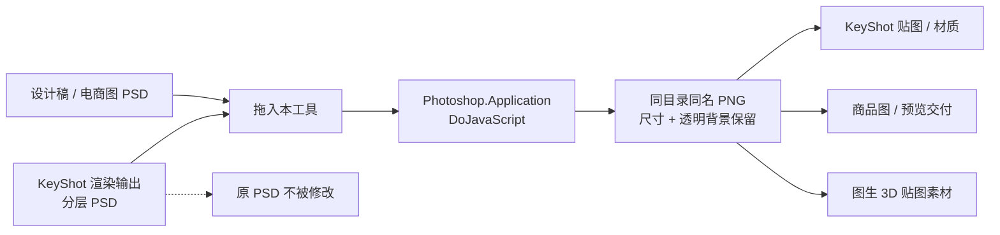
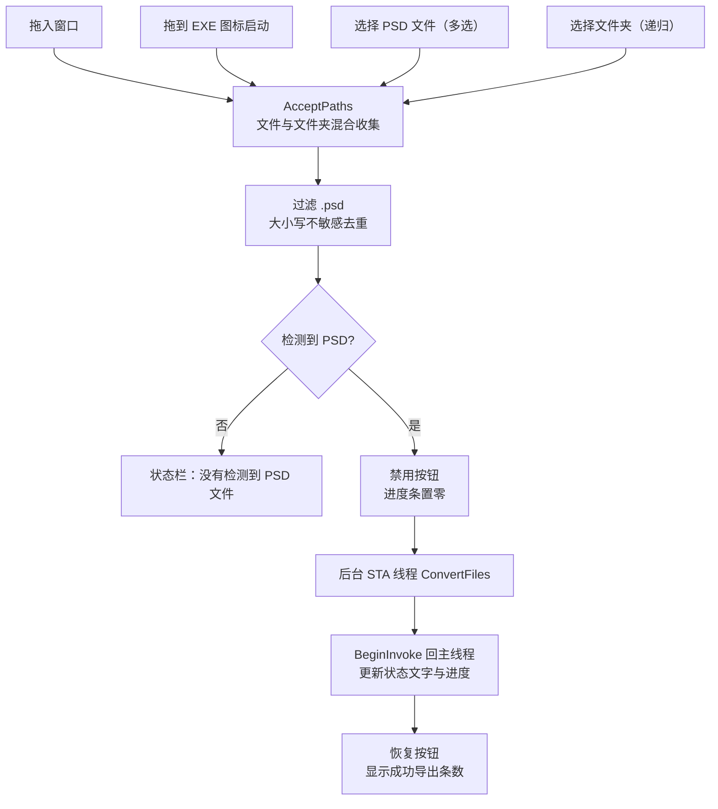
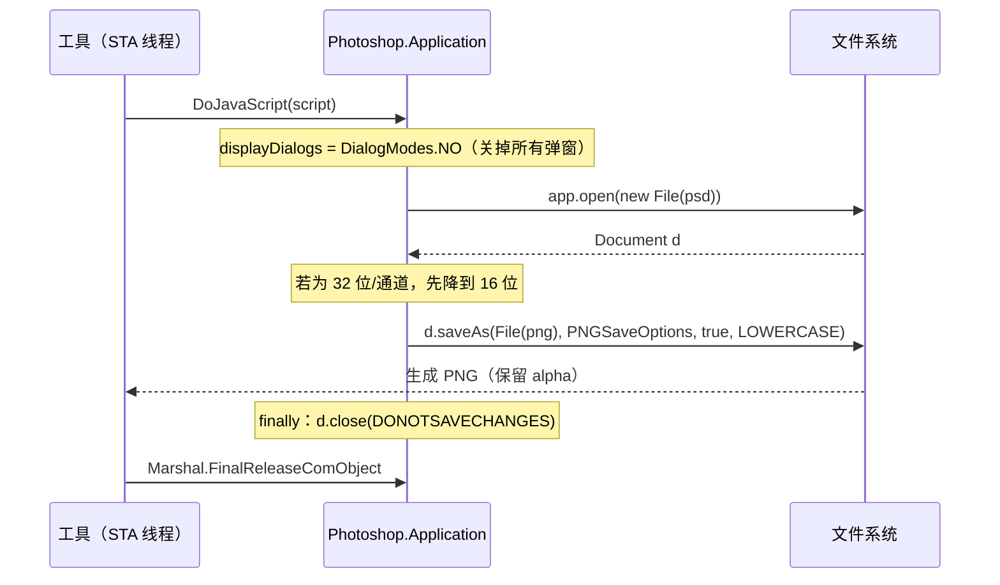
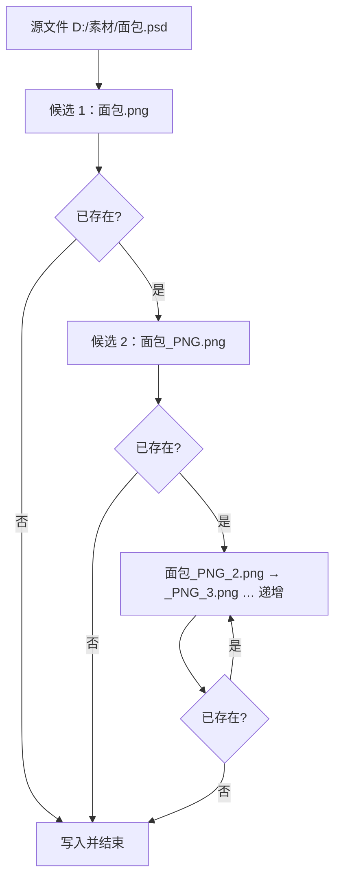

# KeyShot PSD 一键转 PNG · PSD to PNG

> 拖进去，PNG 就出现在原文件旁边。尺寸不变、透明背景保留、原 PSD 一个字节都不动。

`Windows` · `.NET Framework 4.0` · `WinForms` · `Photoshop COM / ExtendScript` · `MIT`

一个 13 KB 的绿色小程序：把 PSD **批量**转成 PNG。它不自己解析 PSD，而是让本机已安装的 Adobe Photoshop 打开并另存——因此图层、混合模式、智能对象、蒙版、色彩配置的最终视觉效果与你在 Photoshop 里「另存为 PNG」完全一致。

界面文案里的「KeyShot PSD」点明了它最初的使用场景：**3D 渲染 / KeyShot 贴图工作流**里，导出的分层 PSD 需要变成带透明通道的 PNG 才能当贴图、预览图或交付素材。工具本身通用，任何 PSD 批量转 PNG 都能用。

---

## 30 秒上手

1. 下载 [`dist/PSD一键转PNG.exe`](dist/PSD一键转PNG.exe)（13 KB，无需安装、无需联网、无配置文件）。
2. 双击打开，把 **PSD 文件或整个文件夹**拖进窗口；也可以点「选择 PSD 文件」多选，或点「选择文件夹」递归处理。
3. 看进度条走完即可。PNG 与源 PSD **同目录同名**，例如 `面包.psd` → `面包.png`。

> 更快的用法：直接把 PSD / 文件夹拖到 EXE **图标**上启动，程序会自动开始转换。

**前置条件**：Windows + 已安装 Adobe Photoshop（桌面完整版）。详见[运行环境](#运行环境与前置条件)。

---

## 它替代掉的那件事

手动转换一张 PSD 要：打开 Photoshop → 文件/打开 → 等待大文档加载 → 另存为 → 选 PNG → 勾选项 → 确认 → 关闭文档不保存。20 张就是 20 遍，中途还常被「缺失字体」「颜色配置文件」「最大化兼容性」之类的弹窗打断。

这个工具把整串动作压成一次拖放，并且关掉所有对话框、自动避开同名文件、无论成功失败都把文档关掉不保存。

---

## 适用什么客户

| 谁 | 具体痛点 | 本工具给什么 |
| --- | --- | --- |
| **3D 渲染师 / KeyShot 用户** | 渲染输出、分层 PSD 要变成贴图或预览 PNG；手动另存打断渲染流程 | 一次拖放批量出图，尺寸与 alpha 原样保留，贴图路径与源文件同目录 |
| **图生 3D / AI 生图工作流** | WorkBuddy `hy-3d` 一类流程产出的贴图素材、材质图常以 PSD 交付，KeyShot 导入前要统一转 PNG | 作为流水线最后一环，配合 [KeyShot-PBR-Texture-Tool](https://github.com/1187574340yangping-hash/KeyShot-PBR-Texture-Tool) 使用 |
| **电商视觉 / 产品图团队** | 大量白底图、透明底 PSD 要批量出 PNG 上架，平台不收 PSD | 选根目录递归处理，输出自动避开同名，重复跑不覆盖已上架的图 |
| **设计助理 / 美工** | 重复的「打开—另存—关闭」机械劳动，还容易漏改扩展名、覆盖旧稿 | 零决策操作，进度条显示当前文件名与 `3/20` 进度 |
| **摄影后期 / 修图工作室** | 客户要 PNG 预览，但原始分层 PSD 必须保持可编辑 | `DONOTSAVECHANGES` 保证原稿绝不被写回 |
| **独立设计师 / 小团队** | 不想为「批量转格式」买插件、装 Action 包或搭脚本环境 | 单 EXE、免安装、只依赖系统自带 .NET 和已有 Photoshop |

> 不适合：需要脱离 Photoshop 独立运行的服务器/CI 环境、macOS、Linux、需要转换 PSB/AI/EPS 或需要自定义 PNG 压缩参数。见[能力边界](#能力边界与已知限制)。

---

## 工作流图解

### 1. 端到端：从 PSD 到可用贴图



### 2. 四种入口收敛成一条流水线



### 3. 单张转换在 Photoshop 里实际发生什么



### 4. 输出命名：永远不覆盖已有文件



---

## 方便什么

- **不用守着 Photoshop**：拖进去就走，进度条显示 `正在转换 3/20：xxx.psd`，大文件有「请耐心等待」提示。
- **不用选输出目录**：结果就在源文件旁边，找贴图时路径直觉一致，不用维护一套输出映射。
- **不会毁稿**：原 PSD 以「不保存更改」关闭；已有 PNG 也不会被覆盖，重复跑自动加 `_PNG`。
- **整个项目一次处理**：选文件夹会递归收集所有 `.psd`，拖入 + 选文件夹重复计入的同一文件会自动去重。
- **零部署**：13 KB 单文件，不用装 .NET 6/8、不用 Python、不用联网、不用账号、不写注册表、没有配置文件。扔进素材盘或共享盘就能给同事用。
- **GUI 与拖放双通道**：既能开窗口慢慢选，也能把文件直接甩到 EXE 图标上批处理。
- **错误说人话**：Photoshop 被占用会提示「Photoshop 忙或无法读取文件」，没装会提示「请先确认 Photoshop 已安装」，而不是抛一段堆栈。

---

## 为什么这样做

| # | 决策 | 原因 |
| --- | --- | --- |
| 1 | **调 Photoshop COM + ExtendScript，不自己解析 PSD** | PSD 有图层、混合模式、智能对象、调整图层、蒙版、32 位 HDR，自己写解析器必然丢效果；让 Photoshop 自己「打开→另存」才是视觉 1:1 |
| 2 | `app.displayDialogs = DialogModes.NO` | 批处理最怕弹窗卡死：缺失字体、颜色配置文件、增效工具提示都会让无人值守的转换停在那里 |
| 3 | 32 位/通道先降到 16 位 | PNG 不支持 32 位浮点通道，不降位会直接保存失败；HDR 渲染输出常见 |
| 4 | `PNGSaveOptions.interlaced = false` | 交错对贴图和预览没有收益，还会增大体积、拖慢部分引擎解码 |
| 5 | `saveAs(..., true, Extension.LOWERCASE)` | 以副本方式另存，扩展名统一小写，避免 `.PNG` 在大小写敏感的引擎/CI 里读不到 |
| 6 | `finally { d.close(SaveOptions.DONOTSAVECHANGES) }` | 无论成功失败都关闭且不保存：既保证原稿不被改，也避免批量转换后 Photoshop 里堆几十个文档吃满内存 |
| 7 | 路径先做 `JsEscape`（`\`→`\\`、`'`→`\'`） | Windows 路径的反斜杠、中文/带单引号的目录名会直接破坏 JS 字符串字面量，表现为「点了没反应」 |
| 8 | 输出写在源 PSD 旁边 | 少一次「请选择输出目录」的决策，素材与导出图同目录便于 KeyShot 引用 |
| 9 | 同名自动 `_PNG` / `_PNG_2` | 反复重跑、增量补图时不会把上一版成果覆盖掉 |
| 10 | 文件夹递归 + `Distinct(OrdinalIgnoreCase)` | 一次选根目录覆盖整个项目；Windows 大小写不敏感，混合输入容易把同一文件计两次 |
| 11 | 后台 **STA** 线程 + `BeginInvoke` 更新 UI | Photoshop COM 必须在 STA 单元；大文件转换不能冻结窗口；WinForms 控件只能主线程碰 |
| 12 | 单独捕获 `COMException` | 「Photoshop 正忙 / 有模态框 / 文件被占用」是最高频故障，要给可操作提示而不是笼统的「失败」 |
| 13 | `Marshal.FinalReleaseComObject` | 释放 COM 引用，避免转换结束后残留 Photoshop 进程 |
| 14 | 单 EXE、无配置、无网络 | 目标用户是设计师不是运维；13 KB 的 .NET 4.0 程序在 Win10/11 上开箱即跑 |

逐条展开、以及原始字节证据见 [`docs/DESIGN.md`](docs/DESIGN.md) 与 [`docs/REVERSE_ENGINEERING.md`](docs/REVERSE_ENGINEERING.md)。

---

## 输出规则

| 情况 | 输出 |
| --- | --- |
| `D:/素材/面包.psd` | `D:/素材/面包.png` |
| 同名 PNG 已存在 | `D:/素材/面包_PNG.png` |
| 再跑一次 | `D:/素材/面包_PNG_2.png`、`_PNG_3.png` … 依次递增 |

- 尺寸与画布不变，透明区域保留为 PNG alpha。
- 像素深度：32 位/通道的 HDR 文档会先降到 16 位再导出。
- 不生成日志、不生成中间文件、不改动源 PSD 的时间戳以外内容。
- 文件名含中文、空格、单引号均可正常处理（已转义）。

---

## 运行环境与前置条件

| 依赖 | 要求 |
| --- | --- |
| 操作系统 | Windows（Win10 / Win11 实测最稳）；WinForms + COM 决定它不能跑在 macOS / Linux |
| 运行时 | .NET Framework 4.0 或更高；Win10/11 自带 4.8，通常无需另装 |
| **Adobe Photoshop** | **必须已安装桌面完整版**，且 COM 组件 `Photoshop.Application` 可用 |
| 不需要 | .NET 6/8、Python、网络连接、管理员权限、注册表写入、配置文件 |

> **最容易被忽略的一点**：这个工具不会附带 Photoshop，也不能在没装 Photoshop 的机器上转换。这是第 1 条设计决策换来的准确性代价。首次使用建议先手动打开一次 Photoshop，把许可/初始化/字体等一次性弹窗处理掉。

---

## 能力边界与已知限制

- **离线可用，但离不开 Photoshop**：每张图都要真实打开文档，大文件、上百图层会很慢，进度条是唯一反馈。
- **只收 `.psd`**：PSB、AI、EPS、TIFF 等不在过滤范围；扩展名判断大小写不敏感。
- **不做 PNG 参数调优**：不提供压缩级别、位深、交错、ICC 嵌入等选项；要精细控制请用 Photoshop 动作或另存对话框。
- **Photoshop 被占用会失败**：如果 Photoshop 正弹着模态框或在执行别的脚本，`DoJavaScript` 会抛 `COMException`，程序提示后继续下一张。
- **单文件无数字签名**：13 KB 的 .NET 小程序未做代码签名，部分杀软可能误报；可用 [`src/`](src/) 里的重建源码自行编译。
- **原版 EXE 不开源**：仓库中的 `dist/PSD一键转PNG.exe` 是原始二进制；`src/` 是依据元数据重建的行为等价参考实现，见 [src/README.md](src/README.md)。

---

## 从源码构建

```bat
cd src
build.bat
```

调用 Windows 自带的 .NET Framework 4.x `csc.exe`，产物 `dist/PsdToPng.rebuilt.exe`。不需要 Visual Studio / SDK / NuGet。完整说明与和原版的差异见 [src/README.md](src/README.md)。

---

## 项目结构

```
psd-to-png/
├── README.md                     ← 本详情页
├── LICENSE                       ← MIT
├── dist/
│   └── PSD一键转PNG.exe           ← 原始可运行程序（13,312 bytes）
├── src/
│   ├── PsdToPng.cs                ← 行为等价的重建源码
│   ├── build.bat                  ← csc 一键编译
│   └── README.md                  ← 源码说明与构建参数
└── docs/
    ├── DESIGN.md                  ← 14 条设计决策逐条展开
    └── REVERSE_ENGINEERING.md     ← 元数据 / 字符串 / JS 模板原始证据
```

---

## FAQ

**双击没反应 / 提示缺 .NET？**
装 .NET Framework 4.0+（Win10/11 一般已自带 4.8，可在「启用或关闭 Windows 功能」里勾选）。

**提示「没有找到 Photoshop」？**
确认装的是 Adobe Photoshop 桌面完整版而非仅看图软件；COM 组件需注册。修复安装 Photoshop 或先手动启动一次通常可解决。

**转换很久没动静？**
大 PSD 需要 Photoshop 真实加载，状态栏会显示当前文件名并带「大文件请耐心等待」。此时不要在 Photoshop 里操作，避免模态框占用 COM。

**会改坏我的 PSD 吗？**
不会。脚本用 `close(SaveOptions.DONOTSAVECHANGES)`，且以副本方式 `saveAs` 到新 PNG。

**透明背景还在吗？**
在。PNG 保留 alpha 通道，这正是它适合当贴图的原因。

**重跑会覆盖上次的 PNG 吗？**
不会，自动加 `_PNG`、`_PNG_2`… 后缀。

**能脱离 Photoshop 用吗 / 能在服务器上跑吗？**
不能，见「为什么这样做」第 1 条。需要无 Photoshop 的方案应改用 PSD 解析库或 ImageMagick，但会牺牲复杂图层效果的还原度。

**杀毒软件报毒？**
未签名的 13 KB .NET 程序容易误报。可核对 SHA-256，或直接用 `src/` 自行编译。

---

## License & 声明

[MIT](LICENSE) · Copyright (c) 2026 1187574340yangping-hash

Adobe、Photoshop、KeyShot 分别为其各自所有者的商标。本工具不随附、不修改、不分发 Photoshop，仅通过系统已注册的 COM 接口调用用户本机安装的软件；转换结果的准确性由本机 Photoshop 决定。使用本工具产生的图片请自行确认符合素材与平台规范。

原始 EXE 校验值：`SHA-256 7e39aa6949d2275b3b32ab80f3951161701b017ebbc5326ef855850632dff2b5`
